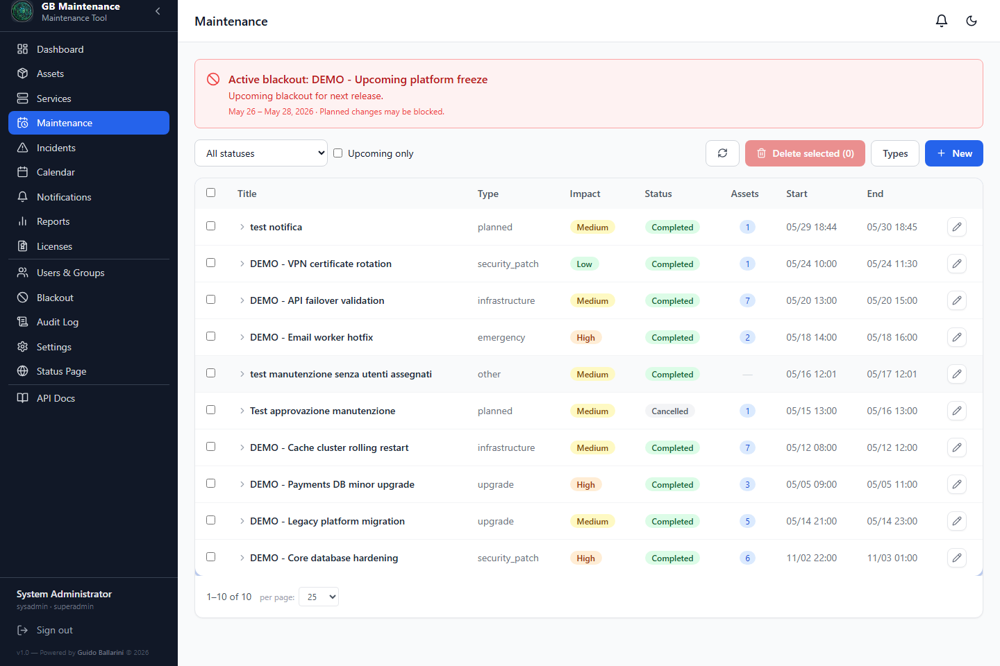
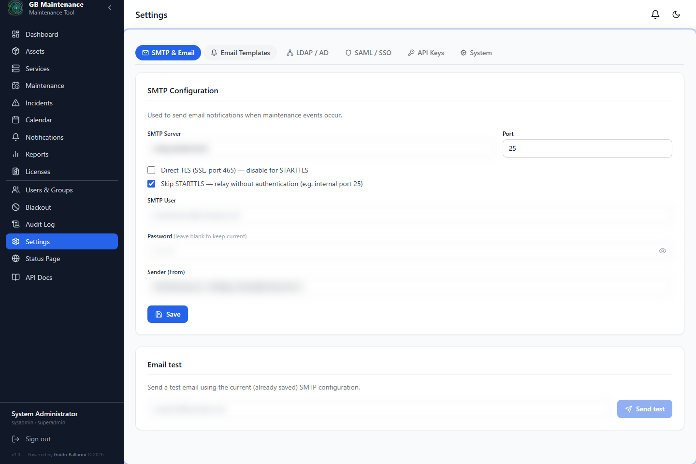
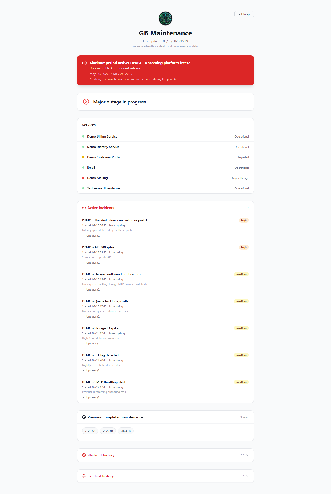

# GB Maintenance - Product Manual

> Automatically generated screenshots and feature walkthrough

## Quick Intro Guide

Each section below highlights one key area of the platform with a desktop screenshot and a short functional description.

### Dashboard Overview

Executive dashboard with the most relevant KPIs and operations snapshot.

Path: /

### Assets Management

Complete asset inventory with operational context and quick filtering.

Path: /assets

### Services Management

Service catalog with ownership and live operational state.

Path: /services

### Maintenance Planning

Planned windows and lifecycle tracking from scheduling to completion.

Path: /maintenance

### Incident Tracking

Incident response panel with severity classification and timeline updates.

Path: /incidents

### Operations Calendar

Visual calendar for maintenance plans and operational events.

Path: /calendar

_Desktop screenshot not available in this revision._

### Notifications Center

Unified communication center with in-app alerts and delivery traceability.

Path: /notifications

### Reporting

Visual analytics and export-ready reports for stakeholders.

Path: /reports

### Licenses Workflow

License lifecycle management, approvals and supplier collaboration.

Path: /licenses

### Settings

Configuration hub for branding, integrations and governance settings.

Path: /settings

### Public Status Page

Public-facing availability overview for services and planned maintenance.

Path: /status

