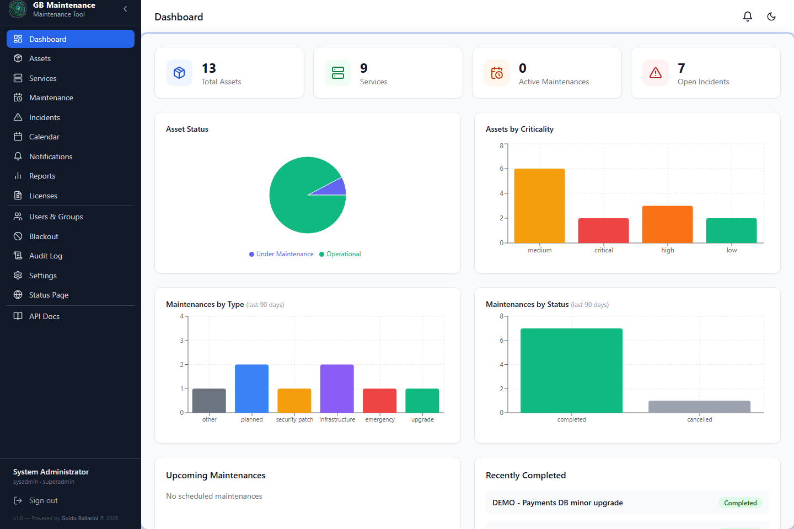
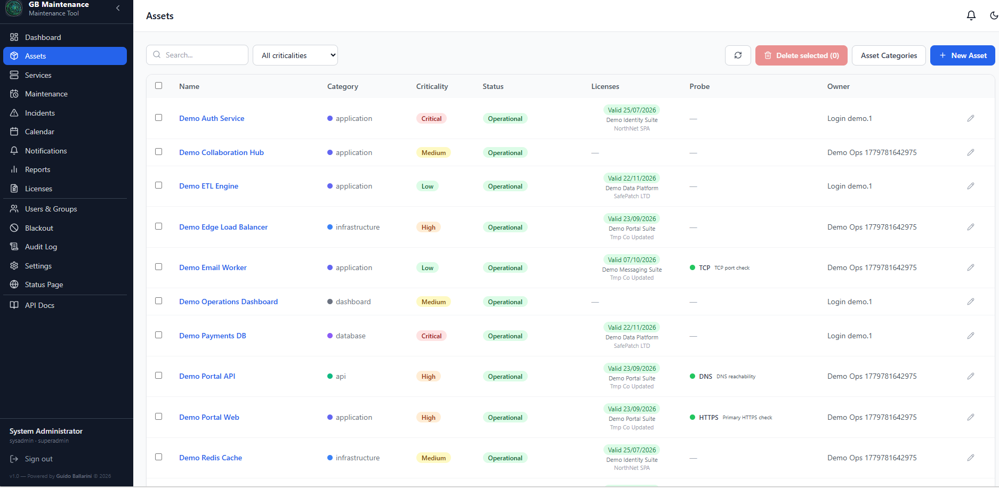
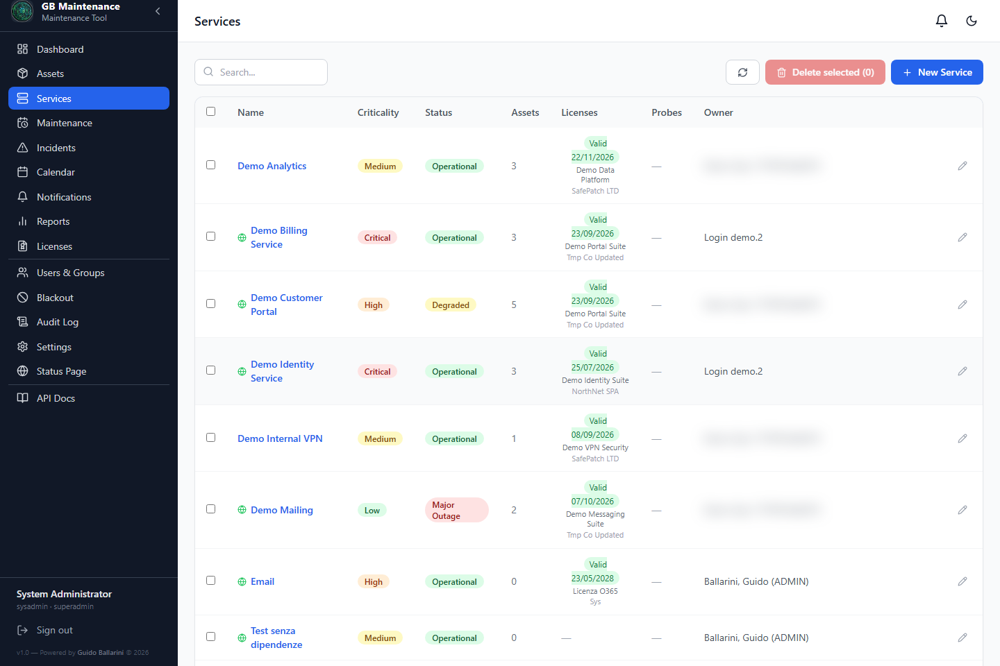
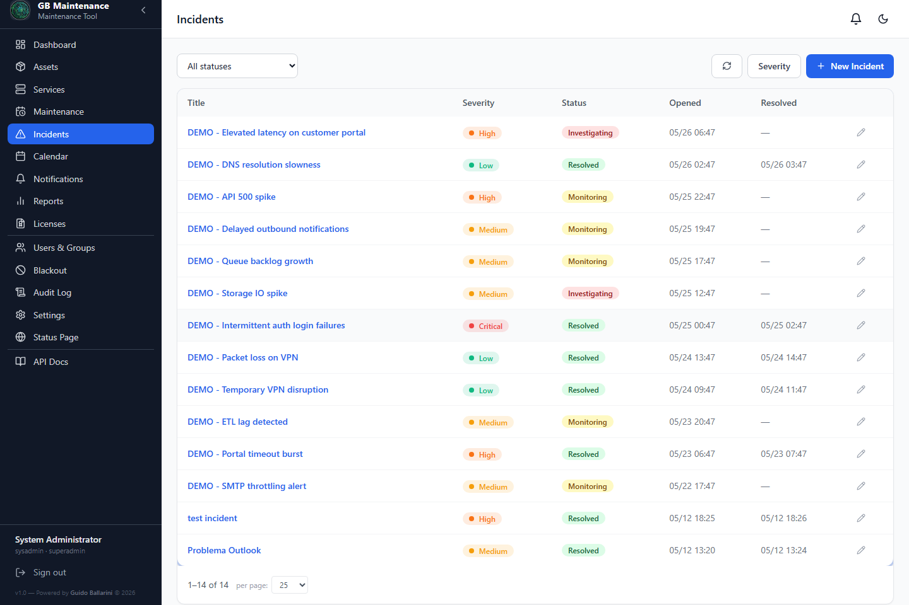
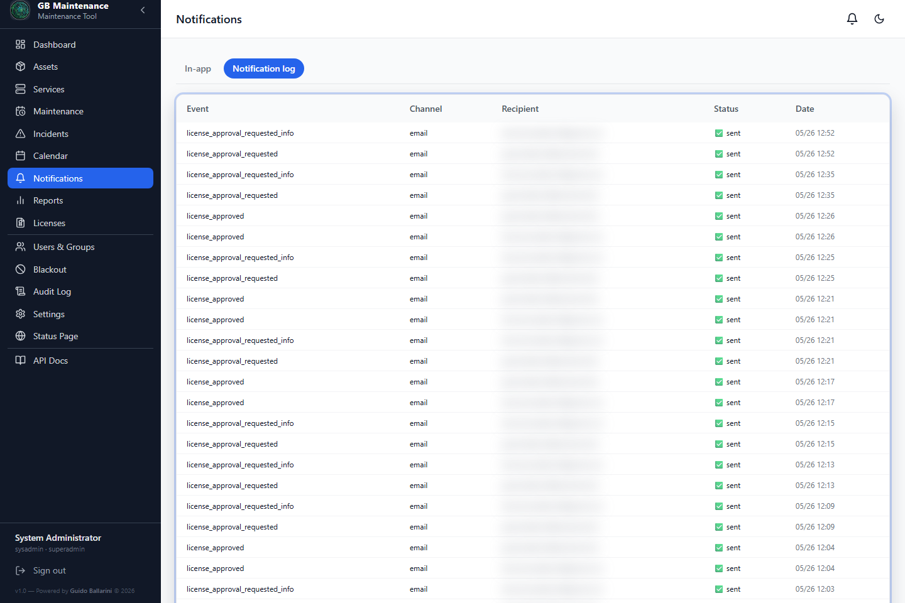
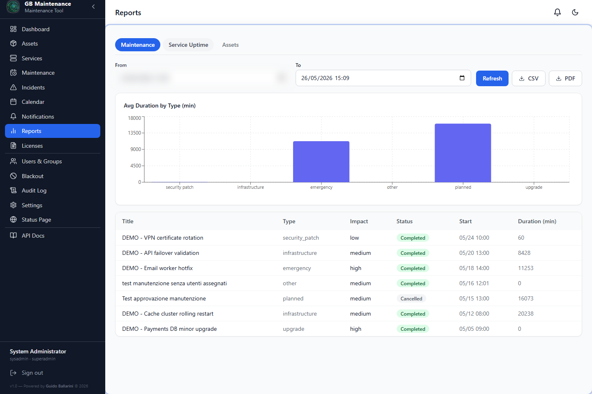
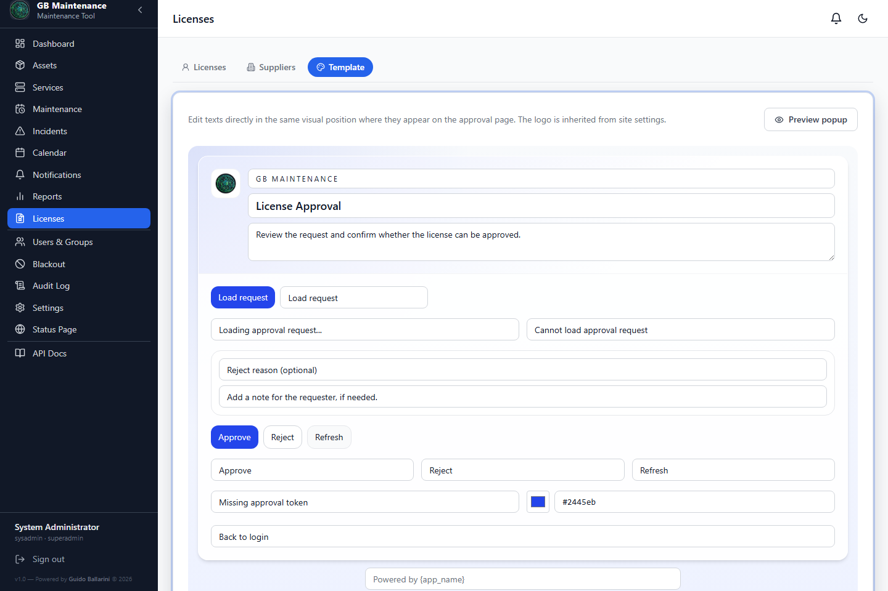

# GB Maintenance - Product Manual

> Automatically generated screenshots and feature walkthrough

Generated at: 2026-05-26T13:05:11.157Z
Base URL: http://localhost:5173

## Feature Walkthrough

### Dashboard Overview

Executive dashboard with the most relevant KPIs and operations snapshot.

Path: /

**Desktop**

**Mobile**

### Assets Management

Complete asset inventory with operational context and quick filtering.

Path: /assets

**Desktop**

**Mobile**

### Services Management

Service catalog with ownership and live operational state.

Path: /services

**Desktop**

**Mobile**

### Maintenance Planning

Planned windows and lifecycle tracking from scheduling to completion.

Path: /maintenance

**Desktop**

**Mobile**

### Incident Tracking

Incident response panel with severity classification and timeline updates.

Path: /incidents

**Desktop**

**Mobile**

### Operations Calendar

Visual calendar for maintenance plans and operational events.

Path: /calendar

**Desktop**

**Mobile**

### Notifications Center

Unified communication center with in-app alerts and delivery traceability.

Path: /notifications

**Desktop**

**Mobile**

### Reporting

Visual analytics and export-ready reports for stakeholders.

Path: /reports

**Desktop**

**Mobile**

### Licenses Workflow

License lifecycle management, approvals and supplier collaboration.

Path: /licenses

**Desktop**

**Mobile**

### Settings

Configuration hub for branding, integrations and governance settings.

Path: /settings

**Desktop**

**Mobile**

